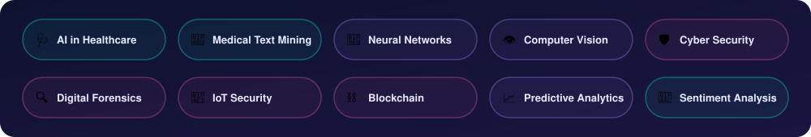

<p align="center">
  
</p>

<p align="center">
  <a href="https://git.io/typing-svg">
    
  </a>
</p>

<p align="center">
  <a href="https://www.linkedin.com/in/sulaxan-jadhav"></a>
  
  
</p>

<p align="center">
  
</p>

<p align="center">
  
</p>


## 👨‍🏫 About Me

Academician, researcher and technologist working where **Artificial Intelligence** meets **healthcare, security and data**. I teach, mentor and build, and I turn research into patents and practical systems.

```python
class DrSulaxanJadhav:
    role       = "Assistant Professor @ Symbiosis School of Economics, SIU Pune"
    education  = ["Postdoc (AI)", "Ph.D. (AI)", "MBA (IT)", "M.Tech (Cyber Security)", "B.E. (Computer)"]
    research   = ["AI in Healthcare", "Medical NLP & Sentiment Analysis", "Cyber Security", "Blockchain"]
    impact     = {"patents": 10, "publications": "10+", "Q1 papers under review": 4}
    currently  = "Teaching Data Analytics & AI · mentoring student research"
    open_to    = ["Research collaborations", "Guest lectures", "Industry–academia projects"]
```

- 🧑‍💻 Led a team of **16 AI/ML developers** to deliver a Resume Parsing system at RecruitNXT
- 🩺 Ph.D. on **sentiment analysis of medical discharge summaries**; postdoc on **neural networks for early diabetes diagnosis**
- 🛡️ Background in **network security**: decentralised banking frameworks, two-factor authentication, system monitoring

<p align="center"></p>

## 🚀 Selected Projects

| Project | What it does | Methods |
|---|---|---|
| [**cascade-sql**](https://github.com/slxnjdhv/cascade-sql) | A small on-device LLM writes SQL, and a calibrated confidence gate decides whether to answer, escalate to a larger model, or abstain. Runs on an 8 GB laptop with no GPU or API. *Paper submitted to the Journal of Intelligent Information Systems.* | LLMs (MLX, Qwen2.5-Coder), calibration, selective prediction, pytest |
| [**inflation-bands-replication**](https://github.com/slxnjdhv/inflation-bands-replication) | Are central-bank inflation fan-chart bands calibrated? A full replication package for every table and figure. | Interval calibration, Diebold–Mariano tests, Holm correction, dynamic-quantile tests |
| [**osteoporosis-nhanes**](https://github.com/slxnjdhv/osteoporosis-nhanes) | Explainable and fair ML screening for osteoporosis in the US NHANES survey, with temporal validation against clinical scores. | XGBoost/LightGBM, Boruta/Lasso feature selection, MICE imputation, SHAP, fairness metrics |

<p align="center"></p>

## 🔬 Research Domains

<p align="center">
  
</p>

<p align="center"></p>

## 📚 Courses I Teach

<p>
  
  
  
  
  
  
  
  
  
  
  
  
  
  
</p>

<p align="center"></p>

## 🛠️ Tech Stack

<p align="left">
  
</p>

- **ML / DL:** PyTorch (LSTM, GRU, Transformer) · scikit-learn · XGBoost · LightGBM · SHAP · MLX
- **Statistics & econometrics:** time-series forecasting (ARIMA, ETS) · panel data / fixed effects · Diebold–Mariano tests · conformal prediction · calibration
- **Data:** pandas · public statistical APIs (Eurostat, CDC NHANES) · reproducible pipelines

<p align="center"></p>

## 💼 Experience

| Role | Organisation | Period |
|---|---|---|
| **Assistant Professor** | Symbiosis School of Economics, SIU, Pune | Dec 2024 – Present |
| **Visiting Faculty** | SICSR, SSODL, SDLC, SIMS, SIBM Pune | Dec 2023 – Present |
| Adjunct Faculty | Symbiosis School of Economics, SIU, Pune | Jul 2024 – Dec 2024 |
| Visiting Faculty | Pimpri Chinchwad College of Engineering | 2023, 2024 |
| Teaching Assistant | D Y Patil International University | Jan 2021 – Aug 2024 |
| Technical Project Manager Intern | RecruitNXT, Delhi | Feb 2022 – Nov 2023 |
| Project Intern | Qollabb Edutech, Bangalore | May 2022 – Aug 2022 |
| Project Intern | Kirloskar Pneumatic Co. Ltd., Pune | May 2019 – Dec 2019 |

<p align="center"></p>

## 🎓 Education

<p align="center">
  
</p>

<p align="center"></p>

## 📄 Selected Publications

- **Sentiment Analysis on Medical Discharge Summaries** — IEEE, 2024
- **Real-Time Design and Enhancement of Trust-Based Security System for IoT Healthcare Monitoring** — IEEE, 2024
- **Bionic Healthcare Innovation Using Artificial and Human Intelligence** — IEEE, 2024
- **Pothole Detection: Instance Detection Based on a Unified Approach for Global Roads** — IEEE, 2023
- **A Hybrid Graph-Attention and Contextual Sentiment Embedding Model for Sentiment Analysis in Legal Documents** — Q2 Journal, ATAIML

<details>
<summary><b>Show all publications</b></summary>

- Plant Disease Detection Using Image Processing — IJSREM, 2024
- Review on Brain Tumor Detection — IJSRD, 2023
- Big Mart Sales Prediction — IJISRT, 2023
- Skin Cancer Classification — IJISRT, 2023
- Efficient Cash Withdrawal from ATMs Using Mobile Banking — 2018
- ➕ Four Scopus Q1 papers communicated and awaiting publication

</details>

<p align="center"></p>

## 💡 Patents

<details>
<summary><b>10 patents in AI, healthcare, IoT, security and blockchain (click to expand)</b></summary>

- 🔐 **Block Secure Ledger: Blockchain-Powered Hardware Wallet** (Jan 2025)
- ❤️ **Compact Defibrillator Device** (accepted Jan 2024)
- 🔒 **AI-Based Security Lock System** (accepted Sep 2023)
- 🧠 System for Measuring Intra-Site Heterogeneity in a Tumor Using AI
- 🧠 Medical Imaging Analysis for Predicting Diagnosis of a Neurobehavioral Disorder
- 🧠 System and Method for Diagnosis of Personalized Brain Disease Using Image Processing
- 🌫️ AI-Based Air Pollution Prediction and Monitoring System
- 🏗️ IoT Employment for Monitoring the Rise of Temperature of Mass Concrete Block
- 🌳 Method for Transmitting Data Between Plurality of Trees and Arrays Using ML
- 🗣️ Method of English Phonetic Teaching Auxiliary Tool and Industry Application

</details>

<p align="center"></p>

## 🤝 Let's Collaborate

I'm always happy to discuss **research collaborations, Ph.D./M.Tech project guidance, guest lectures** and **AI projects with industry**. I can help with:

- Forecasting models with honest out-of-sample evaluation
- Statistical and econometric analysis in Python
- Explainable ML (SHAP) and model reports for non-technical audiences
- Turning research code into clean, reproducible packages
- LaTeX manuscript preparation (Springer / Elsevier templates)

<p align="center">
  <a href="https://www.linkedin.com/in/sulaxan-jadhav"></a>
  <!-- Optional: uncomment and add your IDs
  <a href="https://scholar.google.com/citations?user=YOUR_ID"></a>
  <a href="https://orcid.org/YOUR_ORCID"></a>
  -->
</p>

<p align="center"></p>

## 📊 GitHub Activity

<p align="center">
  
  
</p>

<p align="center">
  
</p>

<p align="center">
  
</p>


<p align="center">
  
</p>
