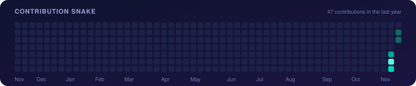

  

  
  <!-- Google Scholar / ORCID: add your links and uncomment
  
  
  -->

I'm an Assistant Professor at the **Symbiosis School of Economics**, Symbiosis International University, Pune, with a Ph.D. and a postdoctoral fellowship in Artificial Intelligence. My research applies machine learning to **healthcare, economics and security**, with an emphasis on models that are evaluated honestly, calibrated and explainable to non-specialists.

- **Currently:** teaching Data Analytics and AI; supervising student research; four Scopus Q1 papers under review
- **Research focus:** medical NLP and sentiment analysis, forecasting and calibration, explainable ML
- **Open to:** research collaborations, project supervision, guest lectures and industry–academia work

  

## Research Projects

| Project | What it does | Methods |
|---|---|---|
| [**cascade-sql**](https://github.com/slxnjdhv/cascade-sql) | A small on-device LLM writes SQL, and a calibrated confidence gate decides whether to answer, escalate to a larger model, or abstain. Runs on an 8 GB laptop with no GPU or API. *Submitted to the Journal of Intelligent Information Systems.* | LLMs (MLX, Qwen2.5-Coder), calibration, selective prediction |
| [**inflation-bands-replication**](https://github.com/slxnjdhv/inflation-bands-replication) | Are central-bank inflation fan-chart bands calibrated? A full replication package for every table and figure. | Interval calibration, Diebold–Mariano tests, Holm correction |
| [**osteoporosis-nhanes**](https://github.com/slxnjdhv/osteoporosis-nhanes) | Explainable and fair ML screening for osteoporosis in the US NHANES survey, with temporal validation against clinical scores. | XGBoost/LightGBM, MICE imputation, SHAP, fairness metrics |

## Research Areas

  

  

## Selected Publications

- **Sentiment Analysis on Medical Discharge Summaries.** IEEE, 2024.
- **Real-Time Design and Enhancement of Trust-Based Security System for IoT Healthcare Monitoring.** IEEE, 2024.
- **Bionic Healthcare Innovation Using Artificial and Human Intelligence.** IEEE, 2024.
- **Design and Implementation of Pothole Detection: Instance Detection Based on a Unified Approach for Global Roads.** IEEE, 2023.
- **A Hybrid Graph-Attention and Contextual Sentiment Embedding Model for Sentiment Analysis in Legal Documents.** ATAIML (Q2).

Other publications

- Plant Disease Detection Using Image Processing. IJSREM, 2024.
- Review on Brain Tumor Detection. IJSRD, 2023.
- Big Mart Sales Prediction. IJISRT, 2023.
- Skin Cancer Classification. IJISRT, 2023.
- Efficient Cash Withdrawal from ATMs Using Mobile Banking. 2018.

## Patents

Ten patents in AI, healthcare, IoT, security and blockchain, including:

- **Block Secure Ledger:** Blockchain-Powered Hardware Wallet (2025)
- **Compact Defibrillator Device** (accepted 2024)
- **AI-Based Security Lock System** (accepted 2023)

All ten patents

- Block Secure Ledger: Blockchain-Powered Hardware Wallet
- Compact Defibrillator Device
- AI-Based Security Lock System
- A System for Measuring Intra-Site Heterogeneity in a Tumor Using Artificial Intelligence
- Medical Imaging Analysis for Predicting Diagnosis of a Neurobehavioral Disorder
- System and Method for Diagnosis of Personalized Brain Disease Using Image Processing
- An Artificial Intelligence-Based Air Pollution Prediction and Monitoring System
- IoT Employment for Monitoring the Rise of the Temperature of Mass Concrete Block
- Method for Transmitting Data Between Plurality of Trees and Arrays Using Machine Learning
- A Method of English Phonetic Teaching Auxiliary Tool and Industry Application

## Experience

| Role | Organisation | Period |
|---|---|---|
| **Assistant Professor** | Symbiosis School of Economics, SIU, Pune | Dec 2024 – present |
| **Visiting Faculty** | SICSR, SSODL, SDLC, SIMS and SIBM, Pune | Dec 2023 – present |
| Adjunct Faculty | Symbiosis School of Economics, SIU, Pune | Jul – Dec 2024 |
| Teaching Assistant | D Y Patil International University, Pune | Jan 2021 – Aug 2024 |
| Technical Project Manager (led 16 AI/ML developers) | RecruitNXT, Delhi | Feb 2022 – Nov 2023 |

Earlier roles

| Role | Organisation | Period |
|---|---|---|
| Visiting Faculty (Java, Database Systems) | Pimpri Chinchwad College of Engineering | Jan–Apr 2023, Jan–Apr 2024 |
| Project Intern (Electronic Medical Record System) | Qollabb Edutech, Bangalore | May – Aug 2022 |
| Project Intern (two-factor authentication) | Kirloskar Pneumatic Co. Ltd., Pune | May – Dec 2019 |

## Education

  

## Teaching

Data Analytics · Python for Data Science · Artificial Intelligence · Neural Networks · Computer Forensics · Social Media Analytics · AI in Marketing, Supply Chain, Operations and Bioinformatics · ERP Development · Digital Marketing · Java · Database Systems

## Toolbox

  

- **ML / DL:** PyTorch (LSTM, GRU, Transformer), scikit-learn, XGBoost, LightGBM, SHAP, MLX
- **Statistics and econometrics:** time-series forecasting (ARIMA, ETS), panel data and fixed effects, Diebold–Mariano tests, conformal prediction, calibration
- **Data:** pandas, public statistical APIs (Eurostat, CDC NHANES), reproducible pipelines, LaTeX (Springer and Elsevier templates)

## Contact

For research collaboration, supervision or guest lectures, reach me on [LinkedIn](https://www.linkedin.com/in/sulaxan-jadhav).

  

